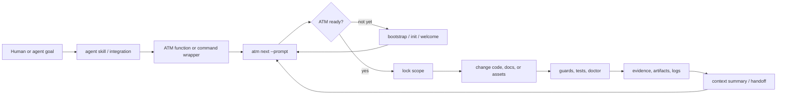
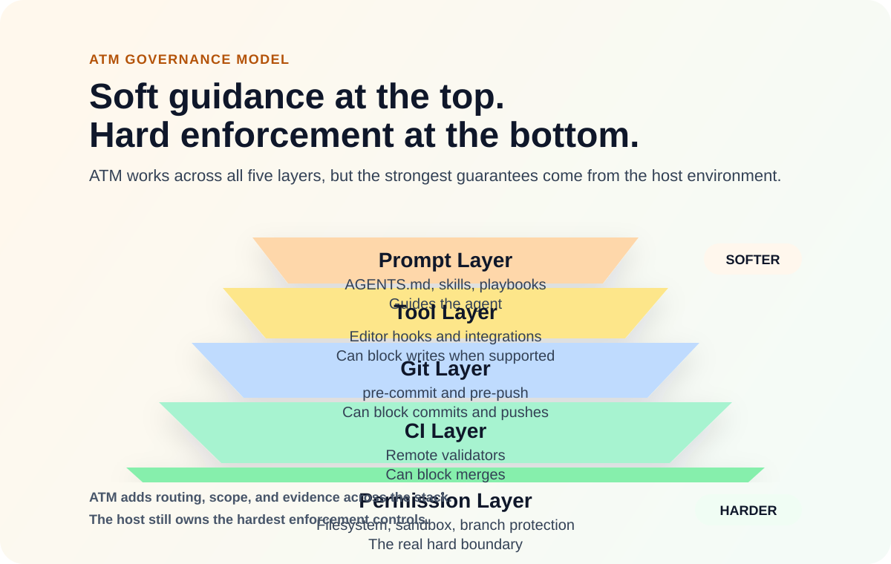

# AI-Atomic-Framework

[](https://github.com/eaglhuang/AI-Atomic-Framework/releases/tag/v0.9.0-alpha.1)
[](https://arxiv.org/abs/2607.00041)
[](https://eaglhuang.github.io/AI-learning-notes/atm_pre_write_admission_paper_en.html)
[](https://github.com/eaglhuang/AI-Atomic-Framework/actions/workflows/ci.yml)
[](LICENSE)
[](docs/ATM_AI_FIRST_5_MIN.md)
[](https://www.npmjs.com/package/create-atm)
[](https://www.npmjs.com/package/@ai-atomic-framework/cli)
[](docs/AGENT_PACK_ONBOARDING.md)
[](release/atm-onefile/atm.mjs)
[](release/atm-root-drop/)

[](#why-atm-exists)
[](#how-it-works)
[](#safety-model)
[](#for-ai-agents)

ATM turns an AI coding request into a bounded, validated change with reviewable evidence.

Tell your agent the outcome; ATM supplies the scope, admission, validation, evidence, and closure contract. Start with one small task and add coordination when your project needs it.

## Start with an outcome

In an ATM-enabled repository, ask your agent:

```text
Use ATM governance to add hello.txt containing exactly "hello" plus one newline.
Change only hello.txt. Check the exact bytes, record the validation evidence,
and formally close the task. Report the commit and evidence paths; stop if
admission, validation, evidence, or closure fails.
```

For your own project, replace the file, outcome, and validator with one bounded change. Success means the actual content, passing checks, formal closure, and evidence you can open. Installing ATM is preparation, not completion of that request.

| Your starting point | Next step |
| --- | --- |
| New project | [Create an ATM project](#new-project). |
| Existing repository | [Set up ATM in that repository](#existing-repository). |
| ATM already installed | [Give your agent the bounded request](#already-installed), or try the [first governed write](#first-governed-write). |

## Install or connect ATM

The published npm runtime supports **Node.js 20+** and npm; Git is required for the starter and governed commits. Framework source contributors use **Node.js 24** and the [contributor workflow](#contributor-workflow). These are different paths.

### New project

<a id="day-1-install"></a>

With Git's author name and email already configured, run:

```bash
npx --yes create-atm@latest my-app --agent cursor --json
cd my-app
```

`cursor` is the literal integration ID in this example. Substitute `claude-code`, `codex`, `copilot`, `gemini`, or `antigravity` for another editor; omit `--agent` for CLI-only setup. In other examples, replace the entire `<editor-id>` placeholder with one of these IDs before running it.

The starter runs `git init` and an initial commit. Check `ok: true` and `ATM_CREATE_READY` before continuing. If it fails at the initial commit, files are retained: inspect the generated directory, configure a Git author there, and follow the reported recovery. Do not blindly stage unrelated files in an existing repository. Git author configuration is distinct from ATM actor identity; see [Git's configuration guide](https://git-scm.com/book/en/v2/Getting-Started-First-Time-Git-Setup).

### Existing repository

<a id="60-second-start"></a>
<a id="add-atm-to-an-existing-repository"></a>

Install a published CLI at a stable location outside your repositories. These paths use Bash on macOS/Linux; replace the target with your actual project directory:

```bash
npm install --prefix "$HOME/atm-runner" @ai-atomic-framework/cli@latest
node "$HOME/atm-runner/node_modules/@ai-atomic-framework/cli/dist/npm-runtime/atm.mjs" setup --cwd /absolute/path/to/existing-repo --agents cursor --dry-run --json
```

Inspect the preview, then run the same setup command without `--dry-run`. Check `ok: true`, the selected target, integration verification, and notices before continuing. Enter that target directory before using its `node atm.mjs` launcher.

`setup` requires CLI 0.1.8+. It detects supported integrations; noninteractive use requires `--agents <ids>` or `--agents none` when none are detected. A comma-separated selection such as `--agents cursor,gemini` overrides detection. Detection does not prove an agent is installed, authenticated, or running.

Setup preserves user-owned integration content or reports conflicts; it does not overwrite conflicts with `--force` or change global agent configuration. Review each conflict and its recovery before retrying. File checks are optimistic preconditions, not an operating-system transaction against arbitrary concurrent writers.

Keep the shared CLI at its original path: a generated launcher can reference it. Each project retains its own tasks, configuration, locks, and evidence; shared invocation is not necessarily zero-copy installation. If the runner moves, restore its location or retain a backup of the generated launcher before reviewing setup from the new location. Setup preserves a differing launcher rather than automatically rebinding it.

### Already installed

Open the project root in your editor, read `AGENTS.md` and the repo-local ATM skill, and give the agent the [bounded request](#start-with-an-outcome). For user-requested work, the official route is:

```bash
node atm.mjs next --prompt "Add hello.txt containing exactly hello plus one newline; change only hello.txt and leave validation and closure evidence." --json
```

Read `evidence.nextAction.playbook` before editing, closing, or committing. Show any `ATM_USER_NOTICE` or `evidence.userNotice` to the user before proceeding. Without a user request, `next --json` is read-only orientation. Installation and welcome do not replace admission for the actual task.

### Versions and distributions

`@latest` is a moving npm tag, not a promise of version 0.1.20. Earlier onboarding checks used **0.1.20**; npm reported **0.1.21** for both packages on 2026-10-20. Pin the product version observed at `evidence.versions.frameworkVersion` in `node atm.mjs welcome --json`. On 0.1.20, `evidence.versions.releaseTrain.frameworkVersion` was `0.0.0`; that is not the product version to pin.

Published packages and release bundles are consumer distributions. The `main` branch is framework development and may differ from the published runtime. Git tag `v0.9.0-alpha.1` is a [paper snapshot](#paper-reproduction), not the npm version.

| Distribution | Use when |
| --- | --- |
| npm `create-atm` | Create a new project. |
| npm `@ai-atomic-framework/cli` | Set up an existing project using a stable external runner. |
| `release/atm-onefile/atm.mjs` | Embed an official single-file runtime, then bootstrap it. |
| `release/atm-root-drop/` | Use the portable multi-file bundle. |

For distributions without `setup`, see [self-hosting](docs/SELF_HOSTING_ALPHA.md) and [integration installation](docs/AGENT_PACK_ONBOARDING.md). Use one official distribution and the local `next` route, rather than a second bootstrap workflow.

## First governed write

Use a **new, empty adopter project**, not this framework repository or a repository with unrelated active work. This example requires **Bash, jq, standard POSIX tools (cmp, od, tr, grep), Git with an author configured, Node.js, and an installed ATM launcher**. It is not a PowerShell script. Run it as one Bash session; `set -e` stops on a failed phase. Retain the evidence directory printed at the end.

The empty-queue path is open → claim → write → evidence → pre-close → close preview → close. Skip `guide`, `orient`, and `start` for this example. `implement-deliverables` means edit the admitted files; it is not a shell command. A conflicting `nextAction.command` does not override the playbook.

The script checks the playbook against this exact bounded workflow. It never evaluates commands returned by ATM. If the current version returns a different playbook, it stops before editing: read that playbook and its notices, then adapt deliberately. Do not remove guards to force it through.

```bash
cd my-app
set -euo pipefail
command -v jq >/dev/null
command -v cmp >/dev/null
command -v od >/dev/null
command -v tr >/dev/null
command -v grep >/dev/null
test -f atm.mjs
test ! -e hello.txt
git var GIT_AUTHOR_IDENT >/dev/null
RUN=$(mktemp -d "${TMPDIR:-/tmp}/atm-hello.XXXXXX")
VALIDATOR="od -An -tx1 hello.txt | tr -d '[:space:]' | grep -qx 68656c6c6f0a"

node atm.mjs taskflow open --write --actor newcomer-ai \
  --title "Add hello.txt" --goal "Create exactly hello plus one newline." \
  --scope-path hello.txt --validator "$VALIDATOR" --json > "$RUN/open.json"
jq -e '.ok == true and (.evidence.generation.taskId | type == "string" and length > 0)' "$RUN/open.json" >/dev/null
TASK=$(jq -r '.evidence.generation.taskId' "$RUN/open.json")
[[ "$TASK" =~ ^[A-Za-z0-9._-]+$ ]]

node atm.mjs next --claim --actor newcomer-ai --task "$TASK" --json > "$RUN/claim.json"
jq -e '.ok == true and (.evidence.nextAction.playbook.commandSequence | type == "array" and length > 0)' "$RUN/claim.json" >/dev/null
jq -e --arg task "$TASK" '.evidence.claimResult.taskId == $task and .evidence.claimResult.actorId == "newcomer-ai" and (.evidence.claimResult.claim.files | index("hello.txt") != null)' "$RUN/claim.json" >/dev/null
jq -e '.evidence.nextAction.targetWork.allowedFiles == ["hello.txt"]' "$RUN/claim.json" >/dev/null
if jq -e '(.evidence.userNotice // .userNotice) != null or any(.messages[]?; .code == "ATM_USER_NOTICE")' "$RUN/claim.json" >/dev/null; then
  jq '{userNotice, messages, playbook: .evidence.nextAction.playbook}' "$RUN/claim.json"
  exit 1
fi
jq '.evidence.nextAction.playbook' "$RUN/claim.json"
LANE=$(jq -er '[.evidence.nextAction.playbook.commandSequence[] | capture("--lane-session (?<lane>[A-Za-z0-9._-]+)") | .lane] | unique | select(length == 1) | .[0]' "$RUN/claim.json")
[[ "$LANE" =~ ^[A-Za-z0-9._-]+$ ]]
BASE="--task $TASK --actor newcomer-ai --lane-session $LANE"
EXPECTED=$(jq -n --arg base "$BASE" --arg v "$VALIDATOR" '[
  "implement-deliverables",
  ("node atm.mjs evidence run " + $base + " --command \"" + $v + "\" --validators \"" + $v + "\" --json"),
  ("node atm.mjs taskflow pre-close " + $base + " --json"),
  ("node atm.mjs taskflow close " + $base + " --json"),
  ("node atm.mjs taskflow close " + $base + " --write --json")
]')
jq -e --argjson expected "$EXPECTED" '.evidence.nextAction.playbook.commandSequence == $expected' "$RUN/claim.json" >/dev/null

# A successful claim and matching playbook are required before this write.
printf 'hello\n' > hello.txt
printf 'hello\n' | cmp -s hello.txt -
node atm.mjs evidence run --task "$TASK" --actor newcomer-ai --lane-session "$LANE" \
  --command "$VALIDATOR" --validators "$VALIDATOR" --json > "$RUN/evidence.json"
jq -e '.ok == true and (.evidence.observedCommandOutcomes | length > 0 and all(.[]; .status == "observed" and .value.exitCode == 0))' "$RUN/evidence.json" >/dev/null
node atm.mjs taskflow pre-close --task "$TASK" --actor newcomer-ai --lane-session "$LANE" --json > "$RUN/pre-close.json"
jq -e '.ok == true' "$RUN/pre-close.json" >/dev/null
node atm.mjs taskflow close --task "$TASK" --actor newcomer-ai --lane-session "$LANE" --json > "$RUN/preview.json"
jq -e '.ok == true and .evidence.writeReadinessHint.status == "ready"' "$RUN/preview.json" >/dev/null
node atm.mjs taskflow close --task "$TASK" --actor newcomer-ai --lane-session "$LANE" --write --json > "$RUN/close.json"
jq -e '.ok == true' "$RUN/close.json" >/dev/null
jq -e '.status == "done"' ".atm/history/tasks/$TASK.json" >/dev/null
COMMIT=$(jq -er '(.commitBundle // .evidence.governedCommitBundle).targetRepo | select(.status == "committed") | .commitSha | select(test("^[0-9a-f]{40}$"))' "$RUN/close.json")
printf 'hello\n' | cmp -s hello.txt -
git show "$COMMIT:hello.txt" | cmp -s hello.txt -
printf 'Task: %s\nCommit: %s\nEvidence: %s\n' "$TASK" "$COMMIT" "$RUN"
```

A successful `close --write` normally commits the deliverables and governance bundle. Inspect its terminal status, commit, and evidence/closure paths; if it reports stage-only, interrupted closure, or missing commit evidence, follow its recovery and report the task as unfinished. Retain these JSON files and the task's `.atm/history` evidence. File existence, install success, or a validator alone is not task completion.

Keep the returned `--lane-session` on every later governed command. Historical 0.1.20 returns `ATM_LANE_BORROWED_ACTOR_BLOCKED` without it. On that version a missing Git author can fail close with `ATM_CLI_UNHANDLED`; Git author configuration and ATM `identity set` differ. Inspect failure output and retry only a safe, confirmed-unexecuted close after resolving its cause. `doctor --json` checks health; it does not deliver or close this task.

## Why ATM Exists

Loose requests can drift before review: agents edit outside the intended boundary, validation results disappear into logs, and the next agent inherits conversation instead of durable context. ATM makes the task the delivery contract, with scope before mutation and evidence before closure.

| What you get | Reviewable outcome |
| --- | --- |
| Agent-native entry | Repo-local guidance routes the request through the official workflow. |
| Scope and admission | The agent knows which change it may make before writing. |
| Validation and evidence | Focused checks and retained artifacts explain whether the outcome passed. |
| Durable handoff | Another person or agent can review, resume, or audit the work. |
| Optional coordination | Broker and lane rules coordinate shared writes as projects grow. |
| Portable contracts | Host-specific enforcement stays in adapters, hooks, or plugins. |


## For AI Agents

New to ATM? Start with [`docs/ATM_AI_FIRST_5_MIN.md`](docs/ATM_AI_FIRST_5_MIN.md).

When you enter an ATM repository for user-requested work:

1. Read the repository entry guidance.
2. Use the repo-local skill or integration when available; it should call ATM's wrapper and end at `node atm.mjs next --prompt "<current user prompt>" --json`.
3. Read `evidence.nextAction.playbook` before editing, closing, or committing.
4. Edit only within the allowed scope returned by ATM.
5. Run the smallest relevant validators and preserve the resulting evidence.

Important details for this framework repository:

- `node atm.mjs` runs the frozen built runner. Use it for normal governance routing and release-like validation.
- `node atm.dev.mjs` is for source-first ATM framework validation only. Do not use it as the default entrypoint for ordinary agent work.
- If ATM recommends `batch`, deliver only the queue head, run `node atm.mjs batch checkpoint --actor <id> --json`, and commit only after checkpoint succeeds.
- README files, generated agent entry files, shell wrappers, and integrations should guide an agent back to `node atm.mjs next --prompt "<current user prompt>" --json`; they should not create a second task model, approval workflow, or rule authority.

Role-routing note: if the user asks for Captain, Coordinator, dispatch, task cards, sidecars, subagents, delegation, condition review, or closeout work, route the request through `ai-role-router` when available, then through `atm-dispatch` before drafting instructions, delegating work, or reviewing another agent. Internal sidecar review is the default; external dispatch is opt-in, and external write requires explicit user authority and scope.

## How It Works



| Stage | Typical command | Expected result |
| --- | --- | --- |
| Route | `node atm.mjs next --prompt "<current user prompt>" --json` | The next governed action and playbook. |
| Bootstrap or orient | `node atm.mjs welcome --json` or init flow | A ready repository with visible local rules. |
| Lock | `atm lock` or channel-specific claim flow | A declared mutation boundary. |
| Work | Normal implementation commands | Actual code, docs, assets, or config changes. |
| Validate | `doctor`, guards, focused validators, tests | Evidence that the requested work passed the required gates. |
| Handoff | `atm handoff --help` | Durable context for the next human or agent pass. |

## Safety Model



ATM keeps the governance layer explicit:

- scope is locked before governed mutation;
- validators and guards are evidence, not just console output;
- artifacts, logs, and reports live in ATM-managed history;
- host-specific enforcement belongs in adapters, hooks, or plugins instead of `packages/core`;
- the deterministic router remains `next`, even when a repository installs welcome flows, agent packs, or shell shortcuts.

## Project Structure

| Path | Purpose |
| --- | --- |
| `packages/` | Framework packages such as core contracts, CLI, adapters, and plugins. |
| `release/` | Official release distributions, including the onefile and root-drop forms. |
| `docs/` | Public framework documentation and governance references. |
| `examples/` | Example adopter setups and integration patterns. |
| `.atm/` | ATM runtime state, evidence, integrations, and generated memory for the local repository. |
| `integrations/` | Agent-specific entry files and installable integration surfaces. |
| `scripts/` | Validators, builders, and framework maintenance tooling. |

## Framework Repo vs Adopter Repo

This repository is the public ATM framework repository, not an adopter project workspace.

Terminology boundary: ATM is the product, framework, CLI, and governance workflow. AI-Atomic-Framework is only this repository name; do not call ATM AAF or use AAF as a shorthand for the framework.

| Repository type | What to do | What not to do |
| --- | --- | --- |
| Framework repo | Keep public framework docs English-only, contributor-facing, and repository-neutral. | Do not store downstream project planning queues, host-specific operating notes, or adopter-only governance rules here. |
| Adopter repo | Keep the ATM route visible, install optional integrations, and layer host enforcement in hooks, CI, or review policy. | Do not replace ATM core contracts with a second registry, second task model, or a competing authority document. |

The Default Governance Bundle is the official default experience, but it is not a `packages/core` hard dependency. Core defines contracts; the default bundle is a reference implementation of those contracts.

## Core Commands

| Command | Purpose |
| --- | --- |
| `node atm.mjs next --prompt "<current user prompt>" --json` | Recommend the next official ATM action for the current user request. |
| `node atm.mjs next --json` | Read-only repository orientation when no user prompt is available. |
| `node atm.mjs welcome --json` | Summarize ATMChart, integration health, and the next ATM action for first-touch onboarding. |
| `node atm.mjs setup --cwd <project> --json` | Onboarding for an existing project: discover, safely install, and verify integrations in one selected project. Requires CLI 0.1.8+. |
| `node atm.mjs doctor --json` | Inspect engineering readiness, layout health, trust signals, version compatibility, and integration drift. |
| `node atm.mjs atm-chart render --json` | Render `.atm/memory/atm-chart.md` from guard sources and schema hashes. |
| `node atm.mjs atm-chart verify --json` | Verify ATMChart freshness and version compatibility. |
| `node atm.mjs integration list --json` | Inspect installed agent integration adapters and manifests. |
| `node atm.mjs lock --help` | Check, acquire, or release governed scope locks. |
| `node atm.mjs test --help` | Run atom smoke, spec, map integration, equivalence, or propagation tests. |
| `node atm.mjs handoff --help` | Write continuation summaries for governed work. |

Per-command help is command-spec driven. `node atm.mjs <command> --help` returns
the command summary, options, examples, and any richer guidance that the spec
declares, including required-flag sets, related commands, common mistakes, and
playbook-oriented notes when a command needs them.

For all available commands, run:

```bash
node atm.mjs --help
```

## Atomic Behaviors

The atom is the main ATM product idea. An atom is not just a task, ticket, command, or prompt. It behaves more like a governed cell in a living codebase: it can divide, fuse, form chains, evolve, go dormant, or attach itself to legacy tissue.

Core defines the `AtomBehavior` interface and evidence schema. Behavior plugins provide the actual moves, and every move should expose the same contract surface: trigger, evidence, gates, registry transition, and rollback.

| Behavior | What it means | Framework signal |
| --- | --- | --- |
| `behavior.split` | One crowded atom divides into two or more focused active atoms. | `split-plan`, new semantic fingerprints, `bornBy: split`. |
| `behavior.merge` | Several compatible atoms fuse into one clearer atom. | `merge-plan`, merged fingerprint, absorbed atoms marked deprecated. |
| `behavior.compose` | Active atoms line up into a reusable map or tree. | Map composition with `members[]` and `edges[]`. |
| `behavior.dedup-merge` | A duplicate atom is swallowed by the surviving atom. | Similarity report, dedup decision, caller refs redirected. |
| `behavior.sweep` | An unused atom goes dormant when nobody calls it. | Unused-caller report, `active -> deprecated`. |
| `behavior.evolve` | An atom keeps its identity while gaining a better version. | Upgrade proposal, quality comparison, automated gates. |
| `behavior.expire` | A deprecated atom reaches TTL and leaves the system. | Expiry report, `deprecated -> expired`. |
| `behavior.polymorphize` | One atom becomes a template with parameterized variants. | Polymorph template, dimension spec, lazy validated instances. |
| `behavior.infect` | An existing atom attaches to matching legacy code and becomes its caller target. | Infect plan, dry-run patch, caller refs added. |
| `behavior.atomize` | A legacy code region transforms into a new governed atom. | Atomize proposal, new atom spec, legacy mapping patch. |

The public behavior naming guidance lives in [docs/governance/behavior-taxonomy.md](docs/governance/behavior-taxonomy.md). The consolidated reference implementation lives in [packages/plugin-behavior-pack](packages/plugin-behavior-pack).

## Architecture In One Page

ATM is organized around contracts first. Implementations may vary, but the semantics should remain portable across languages, repositories, and agent environments.

| Layer | Owns | Must not do |
| --- | --- | --- |
| Core Contracts | `AtomicSpec`, registry records, work items, scope locks, evidence, artifacts, context summaries, adapter reports. | Import default plugins or assume one host layout. |
| Provisioning Facade | Atom and map birth through governed generators such as `ATM-CORE-0004` and `atm create`. | Create a second ID, path, or registry model. |
| Agent Operating Layer | First-touch guidance, AtomicCharter, ATMChart, welcome flow, run envelopes, handoff guidance. | Bind governance to one AI vendor, IDE, or prompt format. |
| Integration Adapters | Agent-native entry files, install/verify/remove lifecycle, `.atm/integrations/<id>.manifest.json`. | Become a second task store or approval workflow. |
| Default Governance Bundle | Replaceable starter plugins for tasks, locks, rules, context budgets, logs, artifacts, and evidence. | Become a hard dependency of `packages/core`. |
| Plugins and Host Adapters | Optional governance capabilities and host-specific storage, Git, CI, issue tracker, language, or runtime integrations. | Push host-specific rules back into core contracts. |

See [docs/ARCHITECTURE.md](docs/ARCHITECTURE.md) for the full layer model.

## Day 2+: coordination

Captain, dispatch, wave, batch, and team flows are advanced workflows, not prerequisites for the first write. Follow the role-routing gate in [For AI Agents](#for-ai-agents) before delegating or reviewing another agent. State `Skill used: atm-dispatch` and the chosen `Delegation mode`. Internal sidecar is the default; external dispatch is opt-in, and external write requires explicit user authority and scope.

## Paper reproduction

The paper snapshot is independent of the published onboarding runtime. Reproduce it in a separate checkout using the contributor runtime requirements for that snapshot:

```bash
git clone https://github.com/eaglhuang/AI-Atomic-Framework
cd AI-Atomic-Framework
git checkout v0.9.0-alpha.1
npm install
npm test -- broker/decision
npm run bench:admission:paper -- --seed 20260625
```

## Historical Batch Lane

For repositories migrating legacy work or completing offline task batches, ATM supports a **historical batch lane**. This allows operators to verify and close tasks using historical commit evidence rather than requiring a live active workspace mutation.

### Core Operations

1. **Author Batch Envelope:**
   Generate a verified historical batch JSON envelope by specifying the target tasks and commit range:
   ```bash
   node atm.mjs evidence historical-batch --tasks TASK-A,TASK-B --commits abc123,def456 --actor <actor-id> --validator-command "npm test" --write --json
   ```

2. **Close Task via Batch:**
   Consume the generated historical batch slice to transition the task status to done:
   ```bash
   node atm.mjs taskflow close --task TASK-A --actor <actor-id> --historical-batch hist-batch-YYYY-MM-DD.json --write --json
   ```

### Key Concepts

- **Coverage Status:** The batch validator maps the file diffs of the matched commits against each task's declared deliverables. If any file is missing, the task is marked as `partial`. It only becomes `complete` (and close-ready) when all declared deliverables are fully matched by the commit history.
- **Diagnostic-Only Behavior:** By default, if the batch validation lacks complete file coverage, the task will refuse to close unless an emergency approval is provided.
- **Validator Mapping:** Each command run in the batch is hashed and recorded, ensuring historical test execution can be proven cryptographically.

## Adopter Guidance

ATM is designed to cooperate with the systems a repository already has.

- Keep `node atm.mjs next --prompt "<current user prompt>" --json` visible in repository entry guidance for user-requested work.
- Use `atm welcome`, ATMChart, and optional integrations to help agents discover the local route.
- Use `atm doctor --json` to inspect readiness and detect possible governance bypass.
- Add Git hooks, CI gates, branch protection, or review policy in the host repository when stronger enforcement is needed.
- Keep host-specific escalation policy outside ATM core.

Host-side enforcement options are documented in [docs/HOST_GOVERNANCE_INTEGRATION.md](docs/HOST_GOVERNANCE_INTEGRATION.md). First-touch onboarding and integration manifests are documented in [docs/AGENT_PACK_ONBOARDING.md](docs/AGENT_PACK_ONBOARDING.md).

## Contributor Workflow

This repository uses npm as the official package-manager route and targets Node.js 24 for source-tree development. TypeScript modules run through `node --experimental-strip-types` in local validators and scripts.

The current implementation uses TypeScript, Node.js, JSON schemas, and a small CLI because those tools make the alpha path easy to inspect and test. That toolchain is a recommendation, not a semantic requirement of ATM; other implementations should remain possible if they preserve the same contracts.

Runner entrypoints are intentionally split:

| Entrypoint | Purpose |
| --- | --- |
| `node atm.mjs ...` | Stable frozen runner for agents, governance routing, and release-like tests inside this repo. It uses `release/atm-onefile/atm.mjs` when present, then the built `packages/cli/dist/atm.js`. |
| `node atm.dev.mjs ...` | Source-first runner for ATM framework development. Use this only when you intentionally need current `packages/cli/src/**` behavior before a build. |

Do not ask agents to use `node atm.dev.mjs` for ordinary governance tests. Build first, then verify the frozen entrypoint with `node atm.mjs ...`.

Install dependencies, then use the standard engineering checks:

```bash
npm install
npm run typecheck
npm run lint
npm test
```

Build and refresh distribution artifacts:

```bash
ATM_RETAIN_RELEASE_ARTIFACTS=1 npm run build
```

Run release-entry smoke checks:

```bash
node release/atm-root-drop/atm.mjs next --json
node release/atm-onefile/atm.mjs next --json
```

Broader validation profiles:

```bash
npm run validate:quick
npm run validate:standard
npm run validate:full
```

Protected-surface neutrality is a release concern. Before changing public docs, templates, examples, schemas, or framework package surfaces, review [docs/governance/DOCS_NEUTRALITY_AUDIT.md](docs/governance/DOCS_NEUTRALITY_AUDIT.md) and run:

```bash
npm run validate:neutrality
```

Versioning policy changes are self-versioned. Before changing release, compatibility matrix, deprecation, or migration policy text, update `policy_version` and confirm `framework_version_range` in [docs/ai_atomic_framework/upstream-versioning-policy.md](docs/ai_atomic_framework/upstream-versioning-policy.md), then run:

```bash
node --experimental-strip-types scripts/validate-policy-self-version.ts --mode validate
```

## What ATM Is Not

ATM is not trying to be:

- a general-purpose agent framework;
- a workflow engine;
- a prompt marketplace;
- a vector database;
- a model evaluation suite;
- a replacement for host project tests or CI;
- a required dependency for every downstream repository;
- a tool that assumes one programming language, editor, AI model, database, or issue tracker.

ATM can coexist with agent frameworks, specification-driven development tools, CI systems, issue trackers, Harness Engineering reporting, and workflow orchestrators. It provides the shared governance contract around that work. See [docs/ECOSYSTEM_POSITIONING.md](docs/ECOSYSTEM_POSITIONING.md).

## Documentation Map

| Topic | Start here |
| --- | --- |
| Architecture and package boundaries | [docs/ARCHITECTURE.md](docs/ARCHITECTURE.md) |
| First-touch onboarding and ATMChart | [docs/AGENT_PACK_ONBOARDING.md](docs/AGENT_PACK_ONBOARDING.md) |
| Host-side enforcement | [docs/HOST_GOVERNANCE_INTEGRATION.md](docs/HOST_GOVERNANCE_INTEGRATION.md) |
| Self-hosting alpha proof | [docs/SELF_HOSTING_ALPHA.md](docs/SELF_HOSTING_ALPHA.md) |
| Bug backlog router | [.agents/skills/atm-bug-backlog/SKILL.md](.agents/skills/atm-bug-backlog/SKILL.md) |
| ATM bug and optimization backlog | [docs/governance/atm-bug-and-optimization-backlog.md](docs/governance/atm-bug-and-optimization-backlog.md) |
| Atom creation and generator provenance | [docs/ATOM_GENERATOR.md](docs/ATOM_GENERATOR.md) |
| Atom workspace layout | [docs/ATOM_SPACE_LAYOUT.md](docs/ATOM_SPACE_LAYOUT.md) |
| Atomic map replacement | [docs/MAP_REPLACEMENT_PROTOCOL.md](docs/MAP_REPLACEMENT_PROTOCOL.md) |
| Long-tail adopter safeguards | [docs/LONGTAIL_USERS.md](docs/LONGTAIL_USERS.md) |
| Contributing | [CONTRIBUTING.md](CONTRIBUTING.md) |
